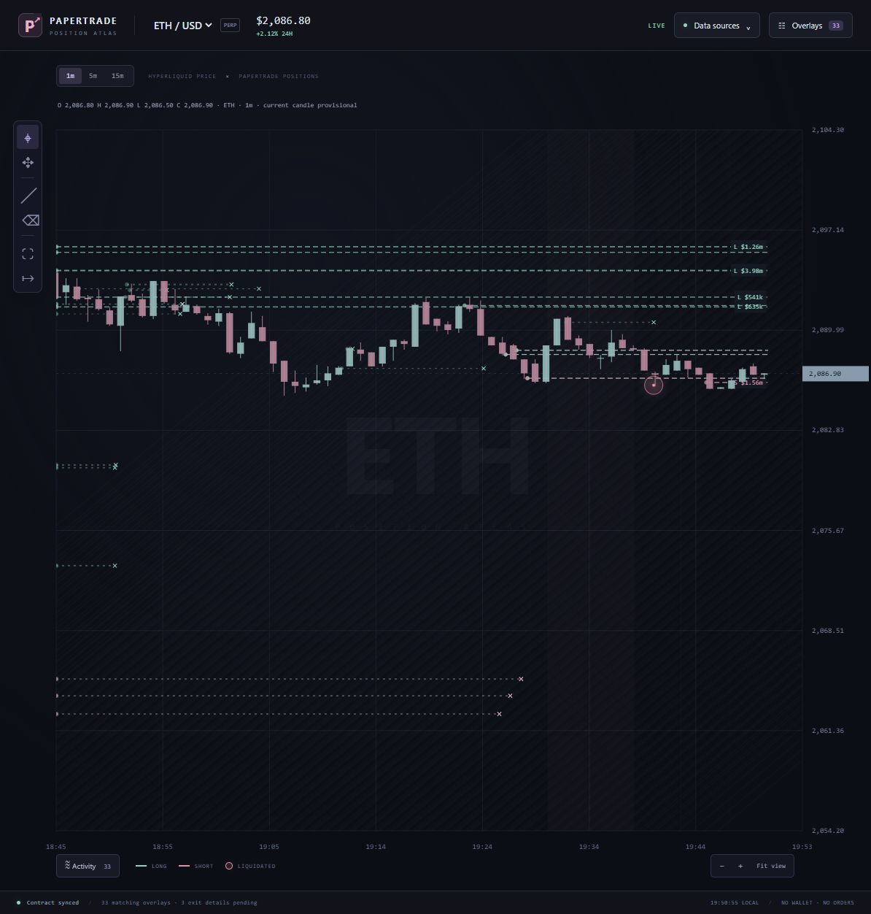

# Papertrade Position Atlas

[Open the live prototype](https://hgosansn.github.io/papertrade_scope/)

A full-page dark chart with Papertrade position lines, liquidation bubbles, overlay filters and drawing tools. Default minimum entry notional: **$100,000**. Version 0.2.0.



## Run locally

Requires Node.js 20 or newer. No dependencies or build step.

```sh
npm start
```

Open http://127.0.0.1:4178/. The server only serves static files; the browser connects directly to public HyperEVM RPC and Hyperliquid's documented WebSocket. No wallet or trading credentials are required.

## Chart controls

- **Overlays:** minimum entry notional, side, lookback, position/liquidation toggles, settled positions and separate display caps. Largest notionals appear first. Filters do not limit collection.
- **Positions:** entry-price lines from opening until an observed close/liquidation. Mint means long; coral means short.
- **Liquidations:** bubbles at actual event time and price, sized by entry notional. Coral means a liquidated long; mint means a liquidated short.
- **Tools:** pan, zoom, crosshair, time/price measurement, fit overlays, return to live time, and 1m/5m/15m reference candles.
- **Data sources:** feed status, pause/resume, export, new observation and a labelled captured-session replay.

## Data contract

Papertrade events are read from public HyperEVM RPC using a checked partial reconstructed interface. The undocumented Papertrade app API is not a runtime dependency. Hyperliquid supplies BTC/ETH reference candles and price context, separate from the synthetic Papertrade positions.

Collection starts at the current block for a new browser dataset, then resumes its saved cursor. This is an observed cohort, not a census of all open positions. Entry notional is margin × leverage, compared with exact 18-decimal integers. Unknown market, notional, side or timestamps suppress overlays instead of inventing values.

See [DECODER.md](DECODER.md) for layouts, code-identity guards, lifecycle rules, provenance and limitations, and [HYPERLIQUID-API.md](HYPERLIQUID-API.md) for the public feed capabilities.

Browser storage is specific to the website origin. Localhost data is separate from the hosted site's data. Collection requires an open running tab; one tab collects per origin. Public RPC availability and rate limits can delay recovery. The journal stops at 12,000 raw records and can be exported before explicitly starting a new observation. Deep reorgs, amendments and multiple partial closes are not fully supported. This prototype makes no profitability claim.

## Replay and tests

**Data sources → Replay captured session** uses real saved observations and public getter/header responses. It is visibly labelled CAPTURED REPLAY and does not overwrite the live dataset. Its liquidations are below $100k, so lower the filter to inspect replay bubbles. Returning to live restores collection.

```sh
npm test
```

28 tests cover transport/reconciliation, threshold boundaries, getter/event agreement, known layouts, lifecycle/reorg replay, missing data, code identity and sparse candle aggregation. Public verification evidence and screenshots are in `evidence/`.

## Deployment and sources

Pushes to `main` run the tests and deploy only `public/` through GitHub Pages. Source and verification files remain available in this repository.

This standalone publication includes the current app and its required public evidence. Earlier dashboard versions, local handover notes and downloaded third-party frontend bundles remain outside this repository. Upstream reconstruction sources and notices are listed in [THIRD_PARTY_NOTICES.md](THIRD_PARTY_NOTICES.md).
