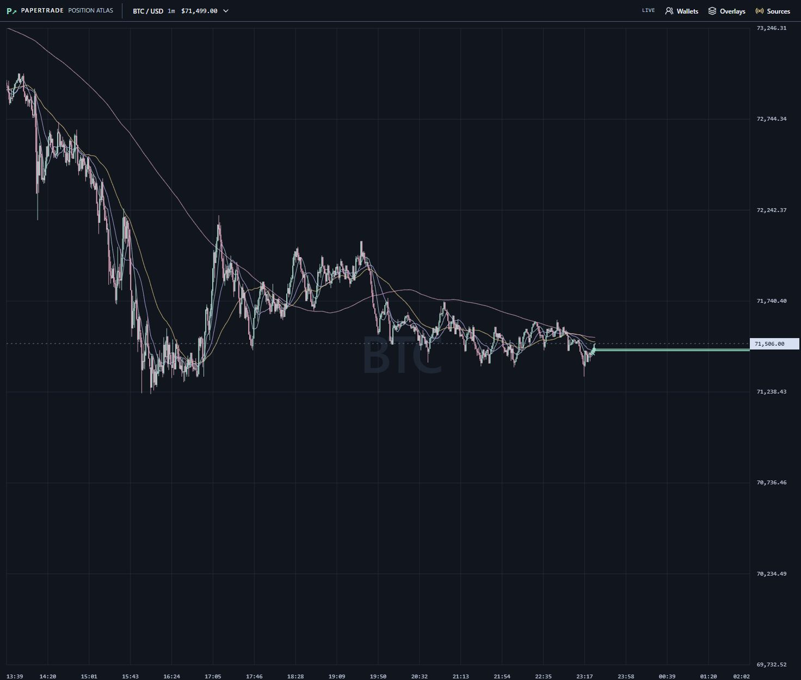

# Paperscope

[Open the live prototype](https://hgosansn.github.io/papertrade_scope/)

A full-page dark chart with Papertrade position lines, liquidation bubbles, a shadcn/ui interface, Tailwind CSS, overlay filters and chart navigation. Default minimum entry notional: **$100,000**. Release: **0.4.0**.



## Run locally

Requires Node.js 20 or newer. The UI uses React, Vite, Tailwind CSS v4 and official shadcn/ui components.

```sh
npm ci
npm start
```

Open http://127.0.0.1:4180/. Vite serves the local frontend; the browser connects directly to public HyperEVM RPC and Hyperliquid's documented WebSocket. No wallet or trading credentials are required.

## Chart controls

- **Event layers:** Positions, Closes and Liquidations each toggle independently, through the right-click Chart menu or the Layers and filters overlay. Preferences persist locally; hiding a layer also dismisses its hover detail and leaves collection/history intact.
- **Layers:** minimum entry notional, side, lookback, independent position/close/liquidation toggles and separate display caps. Largest notionals appear first. Filters do not limit collection.
- **Positions:** open positions only; a decoded close or liquidation removes its entire line and opening dot. Normal closes leave an X at the actual exit time/price; liquidations leave only bubbles. Close X markers and liquidation bubbles scale with entry notional (square-root size scaling), capped at 28px across an X and 60px bubble diameter. Hover either marker for details. The line/close cap applies separately to each layer. Open-position entry-price lines extend to the right edge of the plot, including its future margin, with details shown only on hover, one position at a time: `notional │ leverage │ ≈gross P&L │ profile`. Each section has a matching divider. No permanent badges or long label connectors obscure candles. Click a shared line to choose among overlapping positions; click a value in the hover label to inspect its evidence. Mint means long; coral means short.
- **Liquidations:** bubbles at actual event time and price, sized by entry notional. Coral means a liquidated long; mint means a liquidated short.
- **Trader handle:** the profile handle in the hover label opens observed positions across both markets and all sizes, plus closed/liquidated history and price-based win/loss counts. These are gross price outcomes, excluding fees/funding, not net account results.
- **Wallets:** inspect an address or save it to a browser-local watchlist. Follows provide quick access to future observations collected while the app runs; complete historical backfill and background alerts remain future work.
- **Moving averages:** thin close-price SMA 9, 21, 50 and 200 lines, each toggled independently in Layers. They use the selected candle interval and start only after enough consecutive candles. The current candle is provisional.
- **Tools:** drag the chart to pan in time and price; drag or scroll the right price axis to zoom vertically; double-click that axis for automatic price scaling; wheel/button time zoom, crosshair, Fit view, and 1m/5m/15m reference candles.
- **Data sources:** feed status, pause/resume, export, new observation and a labelled captured-session replay.

## Data contract

Papertrade events are read from public HyperEVM RPC using a checked partial reconstructed interface. The undocumented Papertrade app API is not a runtime dependency. Hyperliquid supplies BTC/ETH reference candles and price context, separate from the synthetic Papertrade positions.

Collection starts at the current block for a new browser dataset, then resumes its saved cursor. This is an observed cohort, not a census of all open positions. Entry notional is margin × leverage, compared with exact 18-decimal integers. Unknown market, notional, side or timestamps suppress overlays instead of inventing values.

See [DECODER.md](DECODER.md) for layouts, code-identity guards, lifecycle rules, provenance and limitations, and [HYPERLIQUID-API.md](HYPERLIQUID-API.md) for the public feed capabilities.

Browser storage is specific to the website origin. Localhost data is separate from the hosted site's data. Collection requires an open running tab; one tab collects per origin. Public RPC availability and rate limits can delay recovery. The journal stops at 12,000 raw records. Starting a new observation atomically archives the old journal locally and preserves candle history; Sources can export the latest archive. Deep reorgs, amendments and multiple partial closes are not fully supported. This prototype makes no profitability claim.

## Replay and tests

**Chart menu → Data sources → Captured replay** uses real saved observations and public getter/header responses. It is visibly labelled CAPTURED REPLAY and does not overwrite the live dataset. Its liquidations are below $100k, so lower the filter to inspect replay bubbles. Returning to live restores collection.

```sh
npm test
```

The tests cover transport/reconciliation, threshold boundaries, getter/event agreement, known layouts, lifecycle/reorg replay, missing data, code identity, sparse candle aggregation, trader summaries, vertical chart interactions, SMA warmup/gaps and theme contrast. Public verification evidence and screenshots are in `evidence/`.

## Deployment and sources

When publication is authorized, pushes to `main` run dependency installation, tests and the Vite build, then deploy only `dist/` through GitHub Pages. Source and verification files remain available in this repository.

This standalone publication includes the current app and its required public evidence. Earlier dashboard versions, local handover notes and downloaded third-party frontend bundles remain outside this repository. Upstream reconstruction sources and notices are listed in [THIRD_PARTY_NOTICES.md](THIRD_PARTY_NOTICES.md).

## Source layout

- `src/components/ui/`: official shadcn primitives; provenance and MIT notice are retained.
- `src/components/desk/`: chart, layers, sources, trader, activity and observation components.
- `src/lib/desk-controller.js`: browser-local data feeds, persistence and replay, separate from presentation.
- `src/lib/`: checked decoder, RPC collector, chart engine, calculations and storage.
- `src/styles/globals.css`: Tailwind import and shared neutral theme tokens.
- `public/`: immutable captured-session data only.

There are no embedded scripts, style blocks or hardcoded JSX style attributes. Dynamic chart-tooltip geometry uses CSS custom properties in the dedicated stylesheet. Radix primitives manage their own positioning and accessibility.

```sh
npm run build
npm run preview
npm run format:check
```

The production build has hashed assets and a relative base URL for the GitHub Pages project path. Source file hashes are recorded in `manifest.json`; generated assets are built by the Pages workflow.

## Theme and contrast

All page colors live in `src/styles/globals.css`: surfaces, text, controls, focus/selection, statuses, semantic trading colors, SMA colors and chart roles. Tailwind utilities map to those variables. `src/lib/chart-theme.js` reads the same tokens for canvas drawing; chart colors refresh when the root theme attributes change. Hover colors inherit semantic tokens directly through CSS.

Text is not faded with opacity to indicate an off state; off layers use readable secondary text plus a strikethrough. Essential input outlines, slider tracks and focus rings have dedicated tokens. Decorative separators, grids and the watermark are separate from essential contrast roles. Chart axis labels and supporting labels are larger.

`test/theme.test.mjs` checks text color pairs at 4.5:1 and essential control/chart-mark pairs at 3:1, including drawn chart opacity. The current 60-pair audit is in `evidence/theme-contrast/contrast-audit.json`. This is a palette audit, not a complete accessibility certification.

## Expanded chart workspace

A minimal 40px Paperscope header contains the instrument/menu button, wallet and overlay shortcuts, and source status. The chart fills the rest of the viewport, with tools in context menus and dismissible overlays.

Right-click anywhere for market, interval, event-layer and SMA toggles, zoom/fit/follow/auto-price navigation, and access to layers/filters, activity, wallets and sources. Right-clicking a position adds its inspection and trader actions. The compact Chart menu button exposes the same options for touch and keyboard users. Larger settings, histories and evidence appear as dismissible overlays. Right-click never initiates a chart drag or left-click inspection.

### Startup price history

The chart opens on a 48-hour price window, independent of the event-layer lookback. BTC and ETH use documented Hyperliquid candle snapshots over WSS for native 1m/5m/15m candles, with 200 extra bars per interval for SMA warmup. Each request stays below the documented 5,000-candle availability limit. The journal retains up to 5,000 candles per market and interval rather than sharing a global cap; old journals remain readable. Cached history is displayed immediately, reconnects request an overlapping tail when the cached series is continuous, and live subscriptions update all three intervals. Data sources reports incomplete backfills; absent candles remain absent. Captured replay retains its captured window. This extends reference prices only; protocol-event observation scope is unchanged.

Source: [Hyperliquid candle snapshot](https://hyperliquid.gitbook.io/hyperliquid-docs/for-developers/api/info-endpoint#candle-snapshot).

The interface uses a 40px header with the Paperscope identity, instrument/interval/price menu, wallet and overlay shortcuts, and source status. The chart occupies the remaining viewport; other tools remain in overlays and the context menu. Shared shadcn primitives and desk panels use square corners and flat surfaces, with thin separators and the existing accessible theme colors.

The chart background is plain with subtle grid lines. Feed-interruption hatching has been removed; recorded interruptions and price-history status remain available in Data sources and the local journal.

The decoder separately approves the current `0x4e2ada...a964` implementation by exact SHA256 after live event/receipt/getter checks. It preserves the original capture and rejects unknown code; see DECODER.md and evidence/implementation-4e2a/. Saved observations can be archived and restarted from the current head without deleting their evidence.
